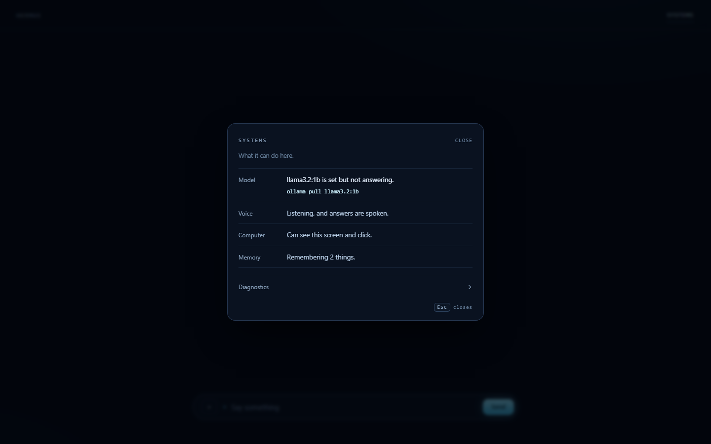

# Hermus — quickstart

A free companion that runs on your own computer. This page is enough to install it,
open it, and get a real answer. The developer path is at the bottom.

The story is the same everywhere: **install → it answers before it asks → the room →
three commands.** The README says it in the same order; `docs/DEVELOPERS.md` holds
everything a person never needs.

---

## 1. Install

**Windows 10/11** — open PowerShell and paste this:

```powershell
$p = Join-Path $env:TEMP "hermus-install.ps1"
Invoke-WebRequest -UseBasicParsing "https://raw.githubusercontent.com/trmv2007-bot/hermus-agent-free/main/install.ps1" -OutFile $p
powershell.exe -NoProfile -ExecutionPolicy Bypass -File $p
```

**macOS, Linux, WSL or Termux** — paste this in a terminal:

```bash
curl -fsSL https://raw.githubusercontent.com/trmv2007-bot/hermus-agent-free/main/install.sh | bash
```

It takes a few minutes, installs into its own folder, never touches your
documents, and running it twice is safe.

## 2. It answers before it asks you anything

You do not need a local model or a key for a first answer. With neither, Hermus
answers through a free endpoint that needs no account — Pollinations first,
OVHcloud AI Endpoints beneath it — and says which one answered and that your words
went there. It also prints the one line that makes it faster.

The installer still offers a model on your own computer, because local is faster
and nothing leaves the machine:

```
No model was found on this machine. Install Ollama (free, no account) and
download llama3.2:1b?  [Y/n]
```

Say yes: about 0.6 GB, once, no account, no cost. Say no and the keyless tier keeps
answering; paste a free-tier key (Groq, Mistral, OpenRouter or Gemini — all free,
no card) if you want a much larger allowance.

## 3. Open it

```bash
hermus
```

That is the whole command. If Hermus is not installed it installs first; if it is
not running it starts; then it opens the room at
**http://127.0.0.1:8000/**. The first time, three choices appear with an answer
already selected, so you can press Enter three times:

- **What should answer you** — the model on your machine, a free key, or nothing.
- **What may it do** — Watch only, Ask first, or Act freely.
- **What should it be called** — `Hermus` unless you have a better idea.

The last step types a real question to the model you chose and streams the answer
back. That is the proof it works. If nothing can answer, it says so once and gives
you the command that fixes it. It does not pretend.

## 4. Use it

After that, the room is one character and one input line. Type, press Enter, read.
Stop is the same button while a turn runs, and an action that needs your yes
arrives as one card in the conversation.

The one quiet control, **Systems**, answers what it can do here in four sentences —
model, voice, computer, memory — and names the single command that fixes anything
missing. Nothing in it is needed to use the product. Everything else the console
can do is behind Diagnostics inside it, and opens only when you ask.



### The three commands

```bash
hermus              # install it if needed, start it, and open the room
hermus undo         # undo the last thing it changed
hermus understand   # what it can and cannot do on this machine
```

Nothing else on the command line is needed to use Hermus. The terminal chat is
still there as `hermus tui`, for working without a browser.

---

## Common questions

**Does it cost anything?** No. Local models are free. The free-tier keys are free
plans with no card. There is no paid tier in this build.

**Does my data leave my computer?** Not with a local model. Only a free-tier key
sends your words to that provider, and never in the default setup.

**Where are my files?** Hermus keeps everything in `~/.hermus` (Windows:
`C:\Users\<you>\.hermus`). Deleting that folder resets it completely, and nothing
outside it is touched.

**How do I change the model or its permissions later?** Open
http://127.0.0.1:8000/welcome. The choice is written into permission overrides you
can edit by hand.

**Nothing answers.** Run `hermus understand` — it prints what can answer here and
what it cannot. `hermus doctor` prints the full diagnosis if that is not enough.

**I changed something I did not mean to.** `hermus undo` puts the last journaled
change back; `hermus undo --list` shows the last few.

---

# Developer path

Everything below assumes you are changing the code. The complete list, grouped by
what each command is for, is `docs/DEVELOPERS.md`.

## From a clone

```bash
git clone https://github.com/trmv2007-bot/hermus-agent-free.git
cd hermus-agent-free
./setup.sh            # Windows: .\setup.cmd
```

`setup.sh` / `setup.ps1` own host detection and packages; `bootstrap.py` owns the
virtualenv, dependencies, data layout and the live Doctor. Useful forms:

```bash
./setup.sh --verify-only     # change nothing, just run the Doctor
./setup.sh --repair          # repair a broken .venv and retry
./setup.sh --skip-optional   # required packages only
```

## Checks

```bash
make test        # pytest tests/ (skips tests/eval), about a minute
make lint        # ruff, whole tree, line length 130
make typecheck
make selfcheck   # offline self-test on mock/mock with a scoreboard
```

`test`, `lint` and `typecheck` must stay green. New behaviour gets a test; the
README's build-status table cites the test behind every row.

## Surfaces

| Address | What it is |
|---|---|
| `/` | The welcome flow while nothing can answer, the companion once it can |
| `/welcome` | The three first-run choices and the model proof |
| `/companion` | The room: character, one input line, Systems |
| `/control` | The developer console: probe panels, engine detail, the doctor |
| `/docs` | OpenAPI |
| `/readyz` | Real readiness, the same answer the boot line prints |

## Optional integrations

Optional packages degrade to an explicit `unavailable` state with a reason; they
never break import, startup or a test. `requirements-optional.txt` lists them.

## Environment

Every field is overridable with a `HERMUS_` prefix (`HERMUS_MODEL`,
`HERMUS_HOME`, `HERMUS_GATEWAY_PORT`, …). `HERMUS_MOCK_UI=1` enables the console's
mock fixture layer, which is a design tool and is disabled otherwise.
