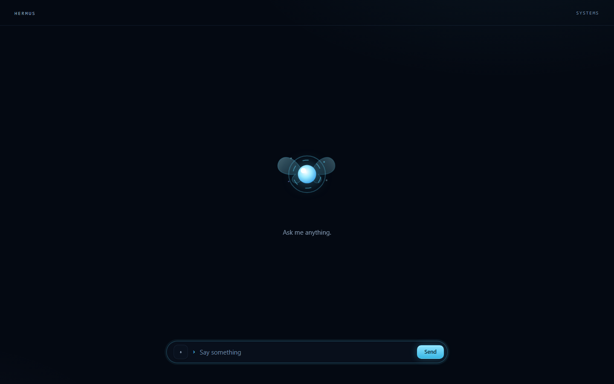

# Hermus



<p align="center">
<a href="https://github.com/trmv2007-bot/hermus-agent-free/actions/workflows/test.yml"></a>
</p>

A free companion that runs on your own computer. It answers, remembers, can work
your desktop when you allow it, and never changes anything without a way back.

It is not a chatbot with a dashboard attached. You open it and there is one
character and one input line; the machinery behind it is reachable, but it is not
the product.

## Install

**Windows 10/11** — PowerShell:

```powershell
$p = Join-Path $env:TEMP "hermus-install.ps1"
Invoke-WebRequest -UseBasicParsing "https://raw.githubusercontent.com/trmv2007-bot/hermus-agent-free/main/install.ps1" -OutFile $p
powershell.exe -NoProfile -ExecutionPolicy Bypass -File $p
```

**Linux, macOS, WSL or Termux**:

```bash
curl -fsSL https://raw.githubusercontent.com/trmv2007-bot/hermus-agent-free/main/install.sh | bash
```

It installs into its own folder, never touches your documents, and running it
twice is safe. A few minutes.

## First run: it answers before it asks you anything

A fresh install resolves a model down a ladder and says which rung answered:

1. a model on your machine — no key, no rate limit, nothing you type leaves the computer;
2. a **keyless** hosted free tier (Pollinations, then OVHcloud AI Endpoints) — no account, no key, no sign-up. The room says so the first time a turn goes there, because "your words left this machine" is not something to leave implicit;
3. a free-tier key, if you pasted one (Groq, Mistral, OpenRouter, Gemini — all free, no card);
4. the offline stub, named as the stub, with the one command that fixes it.

The installer still offers to install a local model, because local is faster and
private: one question, about 0.6 GB, no account. Say yes and the first answer
comes from your own computer. Say no and the keyless tier answers while the
install tells you, in one line, what makes it faster. Nothing is downloaded
without that answer.

The room listens on `127.0.0.1` only, because a command nobody asked for a network
listener from should not open one. `hermus gateway start` is the deliberate version
that binds every interface, for webhooks and a fleet on your LAN.

Setup itself is three choices, each already selected — what should answer you,
what it may do, what it is called — then it types a real question to the model you
chose and streams the answer back as proof. If nothing can answer, it says so once
and gives you the command that fixes it.

## Use it

Three commands. That is the whole command line for a person:

```bash
./hermus              # install it if needed, start it, and open the room
./hermus undo         # undo the last thing it changed
./hermus understand   # what it can and cannot do on this machine
```

The installer puts Hermus in its own folder — `~/hermus-agent-free` on Linux,
macOS, WSL and Termux, `%USERPROFILE%\hermus-agent-free` on Windows — and does not
add it to `PATH`, so run the launcher from there:

```bash
cd ~/hermus-agent-free && ./hermus         # Windows: cd $env:USERPROFILE\hermus-agent-free; .\hermus
```

Add that folder to `PATH` if you want the bare `hermus` everywhere; nothing else is
required.

In the room:

- **Type.** One input line, one answer, streaming as it arrives. Stop is the same
  button while a turn runs.
- **Watch the plan.** A turn with steps shows them above the conversation, and a
  step only advances when a tool result backs it.
- **Approve in place.** An action that needs your yes arrives as one card inside
  the conversation, never as a modal that steals your caret.
- **Systems** is the one quiet control in the corner. It answers four questions —
  model, voice, computer, memory — in four sentences, and names the single command
  that fixes anything missing. Nothing in it is needed to use the room.
- **Ctrl P** goes anywhere else: the plan, the journal, what it remembers.

Everything the operator console can do is behind the room's Systems sheet, under
Diagnostics, and it opens only when you ask for it.

## What it will not do

- **Nothing changes without a way back.** Every mutating action is previewed,
  journaled and undoable with `hermus undo`.
- **No paid service is required or default.** Local models first, free tiers
  second. There is no paid tier in this build.
- **Nothing interrupts you.** No modal, no focus steal, no notification while you
  are typing, in a call, or fullscreen; proactive surfaces batch into a digest.
- **No claim the code does not back.** If a surface is a stub, it says so or it is
  not there. The table below names the test behind every row.

## Build status

Every row names the test that backs it. If a claim has no test, it is not here.
The same suite runs with `make test` on Linux and macOS and with
`py -3 -m pytest tests -q --ignore=tests/eval` on Windows, and on every pull
request. It is platform-neutral by construction: browser code is proven by running
the real frontend files in Node, never through a command line Windows would refuse
to build.

| What you get | The test that backs it |
|---|---|
| A first run that resolves a model, proves it answers, and refuses a profile it cannot honour | `tests/test_first_run_onboarding.py` |
| One input line, one character, one Systems control, and Stop mid-turn, at 1440 and 420 | `tests/browser/test_room.py` |
| Nothing on first open looks like a status board | `tests/browser/test_surfaces.py` |
| A typed question gets its answer, fast, with no pollers left open | `tests/browser/test_first_answer.py` |
| The plan is visible, and each step has its receipt | `tests/browser/test_room_thinking.py` |
| Voice: hold to talk, hear the answer, stop on a word | `tests/test_voice_executive_bridge.py` |
| Every mutation previewed, journaled and undoable | `tests/test_undo_guarantee.py` |
| The undo journal answers over the gateway | `tests/test_undo_routes.py` |
| `hermus understand` answers from a real capability probe | `tests/test_self_model.py` |
| Memory and skills that carry across sessions | `tests/test_learning_loop.py` |
| Quiet proactivity and schedules that stay inside quiet hours | `tests/test_proactive.py`, `tests/test_phase8_scheduler.py` |
| A read-only picture of the desktop | `tests/test_world_awareness.py` |
| Reading and working the desktop under your permission | `tests/test_computer_agent_v2.py` |
| Installing on a fresh machine | `tests/test_bootstrap_runtime.py` |

## Documentation

| Document | Purpose |
|---|---|
| `QUICKSTART.md` | The same story, with the common questions answered |
| `docs/DEVELOPERS.md` | Every developer command, the gates, and the surfaces |
| `CHANGES.md` | What changed, measured, in order |
| `ARCHITECTURE.md` | Canonical architecture reference |
| `RED_LINES.md` | What it will never do, and why |
| `docs/HARNESS.md` | Measuring the agent on task suites |
| `docs/presence.md` | The floating character and its pointer |

## Developers

`./hermus --help` lists three commands first, then everything else under a
Developers heading. The long form of that list is `docs/DEVELOPERS.md`: missions,
harnesses, model fleets, routing, the sentinel, multi-key fan-out, the presence
shell and self-improvement are all still there, all one command away, and none of
them needed to use the product.

```bash
./setup.sh          # Windows: .\setup.cmd
make test           # pytest tests/ (skips tests/eval), about a minute
make lint           # ruff, line length 130
make typecheck
```

## License

MIT. See `LICENSE`.
